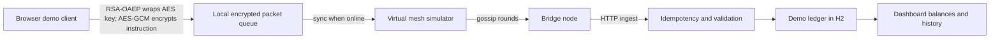

# UPI Offline Mesh Demo

An educational payment-systems prototype that explores how a small, encrypted payment instruction can be carried across an offline device mesh and reconciled when a bridge node reconnects.

> **Demo only. This project does not connect to UPI, a bank, NPCI, or real funds.** It is not suitable for financial use. The browser queue, simulated PIN, H2 ledger, and server-generated keys are not production security controls.

## What it demonstrates

- Browser-side hybrid encryption using RSA-OAEP/SHA-256 and AES-256-GCM.
- Local queueing of encrypted test packets after the dashboard and server public key have been loaded online.
- A software mesh simulator that gossips packets between virtual devices.
- Bridge ingestion, packet freshness checks, tamper detection, and duplicate suppression.
- An H2-backed demo ledger that atomically debits and credits seeded accounts after a packet reaches the backend.
- A responsive dashboard showing devices, account balances, settlement history, and activity.

## Demo flow

1. Start the app and open `http://localhost:8080` once while online. The browser caches the dashboard and the server's current public key.
2. Choose demo accounts and enter a test amount and PIN. The browser encrypts the payment instruction and stores the packet locally. A queued packet is **not** a payment or a promise that settlement will succeed.
3. If the browser is online, **Sync queued packets** sends the packet to the simulated mesh. If offline, the browser keeps it queued until it can reconnect.
4. Run a gossip round to copy packets to virtual phones, then flush the bridge node to the test ledger.
5. Inspect the account balances and transaction ledger to see the simulated settlement or rejection.

The server creates a new RSA keypair at each startup. Packets encrypted with an old key cannot be decrypted after a restart. The local queue is stored in browser local storage and is not protected against device compromise or user modification.

## Architecture



## Tech stack

- Java 17, Spring Boot 3.3, Spring MVC, Spring Data JPA
- H2 in-memory database
- Thymeleaf and browser Web Crypto API
- Maven, Docker, Render Blueprint

## Run locally

Prerequisites: JDK 17+ and network access on first run so Maven Wrapper can download Maven and dependencies.

Windows PowerShell:

```powershell
.\mvnw.cmd spring-boot:run
```

macOS/Linux:

```bash
./mvnw spring-boot:run
```

Then visit `http://localhost:8080`. The wrapper may need network access on first run. If Maven is already installed, `mvn spring-boot:run` also works.

## Build and tests

```bash
./mvnw clean package
./mvnw test
```

On Windows, use `mvnw.cmd`. The included concurrency tests cover encrypted round trips, tamper rejection, and duplicate delivery. The browser offline path requires a secure context; localhost and HTTPS deployments qualify.

## Deploy a demo on Render

This repository includes a Dockerfile and `render.yaml` for a small public demo service.

1. Push this repository to GitHub.
2. In Render, choose **New → Blueprint** and connect the repository.
3. Review the `upi-offline-mesh-demo` service and create it on the Free plan.
4. Wait for the Docker build and health check at `/health` to pass. Render will provide an `onrender.com` URL.

The demo uses an in-memory H2 database: accounts and transactions reset when the service restarts or redeploys. Free web services spin down after 15 minutes without traffic, and the next request can take about a minute to start. Do not enter real PINs or personal data.

## API overview

| Method | Path | Purpose |
|---|---|---|
| `GET` | `/` | Interactive demo dashboard |
| `GET` | `/health` | Host health check |
| `GET` | `/api/server-key` | Current demo RSA public key |
| `GET` | `/api/accounts` | Seeded demo accounts |
| `GET` | `/api/transactions` | Recent simulated settlements |
| `POST` | `/api/mesh/inject` | Inject an already-encrypted demo packet |
| `POST` | `/api/mesh/gossip` | Run one simulated gossip round |
| `POST` | `/api/mesh/flush` | Send bridge-held packets to the demo ledger |
| `POST` | `/api/mesh/reset` | Reset mesh and idempotency cache |
| `POST` | `/api/bridge/ingest` | Demo bridge ingestion pipeline |

## Important limitations

This is not an implementation of UPI Lite, UPI Lite X, Bluetooth/NFC device-to-device communication, or a bank wallet. Device identities and keys are not hardware-backed; offline spending limits are not enforced by a trusted wallet; the demo database and idempotency cache are process-local; the PIN is only a demo field; and there is no bank/PSP/NPCI integration, customer authentication, or production audit trail. Offline acceptance here means only that the browser can queue an encrypted test packet locally. Backend settlement happens later and may reject it.

A real-money product would require a regulated payment partner, an approved payment design, secure wallet provisioning and device-bound controls, durable settlement/idempotency storage, monitoring, audits, and integration/certification outside this codebase.

## Resume description

> Built an educational offline-payment mesh simulator with browser-side hybrid encryption, browser-local packet queueing, simulated gossip routing, and idempotent backend reconciliation using Spring Boot, Java, Web Crypto, and H2.

Use “simulator” or “prototype” in a portfolio description; do not describe it as live UPI or real-money payment software.
